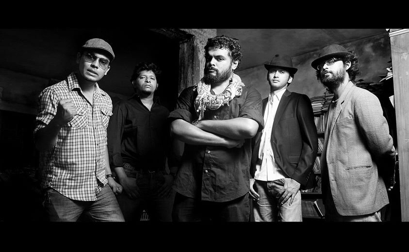

# 🎸 Arbovirus

[](https://github.com/BD-Band-Archive/BD-Band-Music) [](#) [](#) [](#)

<p align="center">
  
</p>

## 🌟 About the Band

> **Arbovirus** Bangladeshi alternative rock music collection with lossless audio and full album packaging artwork.

---

## 📑 Discography Index

1. [64min53sec (৬৪ মিনিট ৫৩ সেকেন্ড) (2006)](#1-64min53sec-2006)
2. [Montobbo Nishproyojon (মন্তব্য নিষ্প্রয়োজন) (2013)](#2-montobbo-nishproyojon-2013)
3. [Bishesh Droshtobyo (বিশেষ দ্রষ্টব্য) (2017)](#3-bishesh-droshtobyo-2017)
4. [Otopor (অতঃপর)](#4-otopor)
5. [Singles & Standalone Releases](#5-singles)

### 💿 Mixed Albums
6. [Agontuk 2 (আগন্তুক ২) (2004)](#6-agontuk-2-আগনতক-২-2004)
7. [Din Bodol (দিন বদল) (2004)](#7-din-bodol-দন-বদল-2004)
8. [Lokayot (2004)](#8-lokayot-2004)
9. [Boka Manushta (বোকা মানুষটা) (2007)](#9-boka-manushta-বক-মনষট-2007)
10. [Live Now (লাইভ নাও) (2007)](#10-live-now-লইভ-নও-2007)
11. [Bonno (বন্য) (2008)](#11-bonno-বনয-2008)
12. [Rock 101 (রক ১০১) (2008)](#12-rock-101-রক-১০১-2008)
13. [Rock 202 (রক ২০২) (2009)](#13-rock-202-রক-২০২-2009)
14. [Rock 505 (রক ৫০৫) (2010)](#14-rock-505-রক-৫০৫-2010)
15. [Rock 606 (রক ৬০৬) (2011)](#15-rock-606-রক-৬০৬-2011)
16. [Rock X0X (রক ১০১০) (2015)](#16-rock-x0x-রক-১০১০-2015)


---

<a id="1-64min53sec-2006"></a>
## 1. 64min53sec (৬৪ মিনিট ৫৩ সেকেন্ড) (2006)

- **Band:** Arbovirus
- **Release Year:** 2006
- **Audio Quality:** Lossless FLAC (16-bit / 44.1 kHz)

<p align="center">
  
</p>

### 🎵 Tracklist (One-Tap Download)


- [**01. Shikarokti**](https://media.githubusercontent.com/media/BD-Band-Archive/Arbovirus/master/64min53sec%20%282007%29/01%20-%20Shikarokti.flac?download=true) &nbsp; [](https://media.githubusercontent.com/media/BD-Band-Archive/Arbovirus/master/64min53sec%20%282007%29/01%20-%20Shikarokti.flac?download=true)
- [**02. Uttaradhikar**](https://media.githubusercontent.com/media/BD-Band-Archive/Arbovirus/master/64min53sec%20%282007%29/02%20-%20Uttaradhikar.flac?download=true) &nbsp; [](https://media.githubusercontent.com/media/BD-Band-Archive/Arbovirus/master/64min53sec%20%282007%29/02%20-%20Uttaradhikar.flac?download=true)
- [**03. Ja Icche Ta**](https://media.githubusercontent.com/media/BD-Band-Archive/Arbovirus/master/64min53sec%20%282007%29/03%20-%20Ja%20Icche%20Ta.flac?download=true) &nbsp; [](https://media.githubusercontent.com/media/BD-Band-Archive/Arbovirus/master/64min53sec%20%282007%29/03%20-%20Ja%20Icche%20Ta.flac?download=true)
- [**04. Mukut Chara Raja**](https://media.githubusercontent.com/media/BD-Band-Archive/Arbovirus/master/64min53sec%20%282007%29/04%20-%20Mukut%20Chara%20Raja.flac?download=true) &nbsp; [](https://media.githubusercontent.com/media/BD-Band-Archive/Arbovirus/master/64min53sec%20%282007%29/04%20-%20Mukut%20Chara%20Raja.flac?download=true)
- [**05. Adhar O Ishshor**](https://media.githubusercontent.com/media/BD-Band-Archive/Arbovirus/master/64min53sec%20%282007%29/05%20-%20Adhar%20O%20Ishshor.flac?download=true) &nbsp; [](https://media.githubusercontent.com/media/BD-Band-Archive/Arbovirus/master/64min53sec%20%282007%29/05%20-%20Adhar%20O%20Ishshor.flac?download=true)
- [**06. Prithibir Shesh Prante**](https://media.githubusercontent.com/media/BD-Band-Archive/Arbovirus/master/64min53sec%20%282007%29/06%20-%20Prithibir%20Shesh%20Prante.flac?download=true) &nbsp; [](https://media.githubusercontent.com/media/BD-Band-Archive/Arbovirus/master/64min53sec%20%282007%29/06%20-%20Prithibir%20Shesh%20Prante.flac?download=true)
- [**07. Omanush**](https://media.githubusercontent.com/media/BD-Band-Archive/Arbovirus/master/64min53sec%20%282007%29/07%20-%20Omanush.flac?download=true) &nbsp; [](https://media.githubusercontent.com/media/BD-Band-Archive/Arbovirus/master/64min53sec%20%282007%29/07%20-%20Omanush.flac?download=true)
- [**08. Amader Gaan**](https://media.githubusercontent.com/media/BD-Band-Archive/Arbovirus/master/64min53sec%20%282007%29/08%20-%20Amader%20Gaan.flac?download=true) &nbsp; [](https://media.githubusercontent.com/media/BD-Band-Archive/Arbovirus/master/64min53sec%20%282007%29/08%20-%20Amader%20Gaan.flac?download=true)
- [**09. Chayamanush**](https://media.githubusercontent.com/media/BD-Band-Archive/Arbovirus/master/64min53sec%20%282007%29/09%20-%20Chayamanush.flac?download=true) &nbsp; [](https://media.githubusercontent.com/media/BD-Band-Archive/Arbovirus/master/64min53sec%20%282007%29/09%20-%20Chayamanush.flac?download=true)
- [**10. Corporate Anthem**](https://media.githubusercontent.com/media/BD-Band-Archive/Arbovirus/master/64min53sec%20%282007%29/10%20-%20Corporate%20Anthem.flac?download=true) &nbsp; [](https://media.githubusercontent.com/media/BD-Band-Archive/Arbovirus/master/64min53sec%20%282007%29/10%20-%20Corporate%20Anthem.flac?download=true)
- [**11. Shekor**](https://media.githubusercontent.com/media/BD-Band-Archive/Arbovirus/master/64min53sec%20%282007%29/11%20-%20Shekor.flac?download=true) &nbsp; [](https://media.githubusercontent.com/media/BD-Band-Archive/Arbovirus/master/64min53sec%20%282007%29/11%20-%20Shekor.flac?download=true)
- [**12. Shorger Shishura**](https://media.githubusercontent.com/media/BD-Band-Archive/Arbovirus/master/64min53sec%20%282007%29/12%20-%20Shorger%20Shishura.flac?download=true) &nbsp; [](https://media.githubusercontent.com/media/BD-Band-Archive/Arbovirus/master/64min53sec%20%282007%29/12%20-%20Shorger%20Shishura.flac?download=true)

### 🖼️ Album Artwork

| | |
| :---: | :---: |
| <br><sub><b>1. Front Cover</b></sub> | <br><sub><b>2. Booklet (Part 1)</b></sub> |
| <br><sub><b>3. Booklet (Part 2)</b></sub> | <br><sub><b>4. Booklet (Part 3)</b></sub> |
| <br><sub><b>5. Booklet (Part 4)</b></sub> | <br><sub><b>6. Booklet (Part 5)</b></sub> |
| <br><sub><b>7. Inset (Front)</b></sub> | <br><sub><b>8. Compact Disc (CD)</b></sub> |
| <br><sub><b>9. Back Inset</b></sub> | <br><sub><b>10. Back Cover</b></sub> |


### 💿 CD Ripper & Preservation Credit

- **Preserved & Ripped by:** Bangla Flac Preservation Community
- **Source:** Original Compact Disc (CD) Lossless Audio Archive

---

<a id="2-montobbo-nishproyojon-2013"></a>
## 2. Montobbo Nishproyojon (মন্তব্য নিষ্প্রয়োজন) (2013)

- **Band:** Arbovirus
- **Release Year:** 2013
- **Audio Quality:** Lossless FLAC (16-bit / 44.1 kHz)

- 
<p align="center">
  
</p>


### 🎵 Tracklist (One-Tap Download)

- [**01. Jaalo Aagun Jaalo**](https://media.githubusercontent.com/media/BD-Band-Archive/Arbovirus/master/Montobbo%20Nishproyojon%20%282013%29/1.%20Jaalo%20Aagun%20Jaalo.flac?download=true) &nbsp; [](https://media.githubusercontent.com/media/BD-Band-Archive/Arbovirus/master/Montobbo%20Nishproyojon%20%282013%29/1.%20Jaalo%20Aagun%20Jaalo.flac?download=true)
- [**02. Roder Kinaray**](https://media.githubusercontent.com/media/BD-Band-Archive/Arbovirus/master/Montobbo%20Nishproyojon%20%282013%29/2.%20Roder%20Kinaray.flac?download=true) &nbsp; [](https://media.githubusercontent.com/media/BD-Band-Archive/Arbovirus/master/Montobbo%20Nishproyojon%20%282013%29/2.%20Roder%20Kinaray.flac?download=true)
- [**03. Hariye Jao**](https://media.githubusercontent.com/media/BD-Band-Archive/Arbovirus/master/Montobbo%20Nishproyojon%20%282013%29/3.%20Hariye%20Jao.flac?download=true) &nbsp; [](https://media.githubusercontent.com/media/BD-Band-Archive/Arbovirus/master/Montobbo%20Nishproyojon%20%282013%29/3.%20Hariye%20Jao.flac?download=true)
- [**04. Aw**](https://media.githubusercontent.com/media/BD-Band-Archive/Arbovirus/master/Montobbo%20Nishproyojon%20%282013%29/4.%20Aw.flac?download=true) &nbsp; [](https://media.githubusercontent.com/media/BD-Band-Archive/Arbovirus/master/Montobbo%20Nishproyojon%20%282013%29/4.%20Aw.flac?download=true)
- [**05. Durotto**](https://media.githubusercontent.com/media/BD-Band-Archive/Arbovirus/master/Montobbo%20Nishproyojon%20%282013%29/5.%20Durotto.flac?download=true) &nbsp; [](https://media.githubusercontent.com/media/BD-Band-Archive/Arbovirus/master/Montobbo%20Nishproyojon%20%282013%29/5.%20Durotto.flac?download=true)
- [**06. Sharthopor**](https://media.githubusercontent.com/media/BD-Band-Archive/Arbovirus/master/Montobbo%20Nishproyojon%20%282013%29/6.%20Sharthopor.flac?download=true) &nbsp; [](https://media.githubusercontent.com/media/BD-Band-Archive/Arbovirus/master/Montobbo%20Nishproyojon%20%282013%29/6.%20Sharthopor.flac?download=true)
- [**07. Prolaap**](https://media.githubusercontent.com/media/BD-Band-Archive/Arbovirus/master/Montobbo%20Nishproyojon%20%282013%29/7.%20Prolaap.flac?download=true) &nbsp; [](https://media.githubusercontent.com/media/BD-Band-Archive/Arbovirus/master/Montobbo%20Nishproyojon%20%282013%29/7.%20Prolaap.flac?download=true)
- [**08. Bodle Gechhe**](https://media.githubusercontent.com/media/BD-Band-Archive/Arbovirus/master/Montobbo%20Nishproyojon%20%282013%29/8.%20Bodle%20Gechhe.flac?download=true) &nbsp; [](https://media.githubusercontent.com/media/BD-Band-Archive/Arbovirus/master/Montobbo%20Nishproyojon%20%282013%29/8.%20Bodle%20Gechhe.flac?download=true)


### 🖼️ Album Artwork

| | |
| :---: | :---: |
| <br><sub><b>1. Cover</b></sub> |  |


### 💿 CD Ripper & Preservation Credit

- **Preserved & Ripped by:** sussybakaballs
- **Source:** Original Compact Disc (CD) Lossless Audio Archive

---

<a id="3-bishesh-droshtobyo-2017"></a>
## 3. Bishesh Droshtobyo (বিশেষ দ্রষ্টব্য) (2017)

- **Band:** Arbovirus
- **Release Year:** 2017
- **Audio Quality:** Lossless FLAC (16-bit / 44.1 kHz)

<p align="center">
  
</p>


### 🎵 Tracklist (One-Tap Download)

- [**01. Mukhosh**](https://media.githubusercontent.com/media/BD-Band-Archive/Arbovirus/master/Bishesh%20Droshtobyo%20%282017%29/1.%20Mukhosh.flac?download=true) &nbsp; [](https://media.githubusercontent.com/media/BD-Band-Archive/Arbovirus/master/Bishesh%20Droshtobyo%20%282017%29/1.%20Mukhosh.flac?download=true)
- [**02. Shurjo**](https://media.githubusercontent.com/media/BD-Band-Archive/Arbovirus/master/Bishesh%20Droshtobyo%20%282017%29/2.%20Shurjo.flac?download=true) &nbsp; [](https://media.githubusercontent.com/media/BD-Band-Archive/Arbovirus/master/Bishesh%20Droshtobyo%20%282017%29/2.%20Shurjo.flac?download=true)
- [**03. Nilam**](https://media.githubusercontent.com/media/BD-Band-Archive/Arbovirus/master/Bishesh%20Droshtobyo%20%282017%29/3.%20Nilam.flac?download=true) &nbsp; [](https://media.githubusercontent.com/media/BD-Band-Archive/Arbovirus/master/Bishesh%20Droshtobyo%20%282017%29/3.%20Nilam.flac?download=true)
- [**04. Tomader Shommane**](https://media.githubusercontent.com/media/BD-Band-Archive/Arbovirus/master/Bishesh%20Droshtobyo%20%282017%29/4.%20Tomader%20Shommane.flac?download=true) &nbsp; [](https://media.githubusercontent.com/media/BD-Band-Archive/Arbovirus/master/Bishesh%20Droshtobyo%20%282017%29/4.%20Tomader%20Shommane.flac?download=true)
- [**05. Bhenge Felo**](https://media.githubusercontent.com/media/BD-Band-Archive/Arbovirus/master/Bishesh%20Droshtobyo%20%282017%29/5.%20Bhenge%20Felo.flac?download=true) &nbsp; [](https://media.githubusercontent.com/media/BD-Band-Archive/Arbovirus/master/Bishesh%20Droshtobyo%20%282017%29/5.%20Bhenge%20Felo.flac?download=true)
- [**06. School**](https://media.githubusercontent.com/media/BD-Band-Archive/Arbovirus/master/Bishesh%20Droshtobyo%20%282017%29/6.%20School.flac?download=true) &nbsp; [](https://media.githubusercontent.com/media/BD-Band-Archive/Arbovirus/master/Bishesh%20Droshtobyo%20%282017%29/6.%20School.flac?download=true)
- [**07. Oshonglognota**](https://media.githubusercontent.com/media/BD-Band-Archive/Arbovirus/master/Bishesh%20Droshtobyo%20%282017%29/7.%20Oshonglognota.flac?download=true) &nbsp; [](https://media.githubusercontent.com/media/BD-Band-Archive/Arbovirus/master/Bishesh%20Droshtobyo%20%282017%29/7.%20Oshonglognota.flac?download=true)
- [**08. Bondhur Lash**](https://media.githubusercontent.com/media/BD-Band-Archive/Arbovirus/master/Bishesh%20Droshtobyo%20%282017%29/8.%20Bondhur%20Lash.flac?download=true) &nbsp; [](https://media.githubusercontent.com/media/BD-Band-Archive/Arbovirus/master/Bishesh%20Droshtobyo%20%282017%29/8.%20Bondhur%20Lash.flac?download=true)
- [**09. Tomar Gaan**](https://media.githubusercontent.com/media/BD-Band-Archive/Arbovirus/master/Bishesh%20Droshtobyo%20%282017%29/9.%20Tomar%20Gaan.flac?download=true) &nbsp; [](https://media.githubusercontent.com/media/BD-Band-Archive/Arbovirus/master/Bishesh%20Droshtobyo%20%282017%29/9.%20Tomar%20Gaan.flac?download=true)


### 🖼️ Album Artwork

| | |
| :---: | :---: |
| <br><sub><b>1. Front Cover</b></sub> | <br><sub><b>2. Gatefold Artwork</b></sub> |
| <br><sub><b>3. Compact Disc (CD)</b></sub> |  |


### 💿 CD Ripper & Preservation Credit

- **Preserved & Ripped by:** sussybakaballs
- **Source:** Original Compact Disc (CD) Lossless Audio Archive

---

<a id="4-otopor"></a>
## 4. Otopor (অতঃপর)

- **Band:** Arbovirus
- **Audio Quality:** Lossless FLAC (16-bit / 44.1 kHz)

<p align="center">
  
</p>
- **Audio Quality:** Lossless FLAC (16-bit / 44.1 kHz)

### 🎵 Tracklist (One-Tap Download)

- [**01. Ami Amari Moto**](https://media.githubusercontent.com/media/BD-Band-Archive/Arbovirus/master/Otopor/1.%20Ami%20Amari%20Moto.flac?download=true) &nbsp; [](https://media.githubusercontent.com/media/BD-Band-Archive/Arbovirus/master/Otopor/1.%20Ami%20Amari%20Moto.flac?download=true)
- [**02. Shottogatha**](https://media.githubusercontent.com/media/BD-Band-Archive/Arbovirus/master/Otopor/2.%20Shottogatha.flac?download=true) &nbsp; [](https://media.githubusercontent.com/media/BD-Band-Archive/Arbovirus/master/Otopor/2.%20Shottogatha.flac?download=true)
- [**03. Nishshongo Groho**](https://media.githubusercontent.com/media/BD-Band-Archive/Arbovirus/master/Otopor/3.%20Nishshongo%20Groho.flac?download=true) &nbsp; [](https://media.githubusercontent.com/media/BD-Band-Archive/Arbovirus/master/Otopor/3.%20Nishshongo%20Groho.flac?download=true)

---


### 🖼️ Album Artwork

| | |
| :---: | :---: |
| <br><sub><b>1. Front Cover</b></sub> |  |


### 💿 CD Ripper & Preservation Credit

- **Preserved & Ripped by:** Bangla Flac Preservation Community
- **Source:** Original Compact Disc (CD) Lossless Audio Archive

---

<a id="5-singles"></a>
## 5. Singles & Standalone Releases

- **Band:** Arbovirus
- **Audio Quality:** Lossless FLAC (16-bit / 44.1 kHz)

<p align="center">
  
</p>

### 🎵 Tracklist (One-Tap Download)

- [**01. Arbovirus - INDRIYO**](https://media.githubusercontent.com/media/BD-Band-Archive/Arbovirus/master/Singles/01.%20Arbovirus%20-%20INDRIYO.flac?download=true) &nbsp; [](https://media.githubusercontent.com/media/BD-Band-Archive/Arbovirus/master/Singles/01.%20Arbovirus%20-%20INDRIYO.flac?download=true)
- [**01. Arbovirus - KROUDH**](https://media.githubusercontent.com/media/BD-Band-Archive/Arbovirus/master/Singles/01.%20Arbovirus%20-%20KROUDH.flac?download=true) &nbsp; [](https://media.githubusercontent.com/media/BD-Band-Archive/Arbovirus/master/Singles/01.%20Arbovirus%20-%20KROUDH.flac?download=true)
- [**Arbovirus - Purono Thikana**](https://media.githubusercontent.com/media/BD-Band-Archive/Arbovirus/master/Singles/Arbovirus%20-%20Purono%20Thikana.flac?download=true) &nbsp; [](https://media.githubusercontent.com/media/BD-Band-Archive/Arbovirus/master/Singles/Arbovirus%20-%20Purono%20Thikana.flac?download=true)
- [**HOYTO - Arbovirus**](https://media.githubusercontent.com/media/BD-Band-Archive/Arbovirus/master/Singles/HOYTO%20-%20Arbovirus.flac?download=true) &nbsp; [](https://media.githubusercontent.com/media/BD-Band-Archive/Arbovirus/master/Singles/HOYTO%20-%20Arbovirus.flac?download=true)

### 🖼️ Album Artwork

| | |
| :---: | :---: |
| <br><sub><b>1. Front Cover</b></sub> | <br><sub><b>2. folder</b></sub> |


### 💿 CD Ripper & Preservation Credit

- **Preserved & Ripped by:** @music_ripper_bot / Bangla Flac Community
- **Source:** Original Compact Disc (CD) Lossless Audio Archive

---

---

<a id="6-agontuk-2-আগনতক-২-2004"></a><a id="6-agontuk-2-2004"></a><a id="5-agontuk-2-2004"></a>
## 6. [Agontuk 2 (আগন্তুক ২) (2004)](https://github.com/BD-Band-Archive/Mixed-Albums#5-agontuk-2-2004)
### 🎵 Tracklist (One-Tap Download)

- [**Arbovirus - Artonaad**](https://media.githubusercontent.com/media/BD-Band-Archive/Mixed-Albums/master/Agontuk%202%20%282004%29/06%20-%20Arbovirus%20-%20Artonaad.flac?download=true) &nbsp; [](https://media.githubusercontent.com/media/BD-Band-Archive/Mixed-Albums/master/Agontuk%202%20%282004%29/06%20-%20Arbovirus%20-%20Artonaad.flac?download=true)

---

<a id="7-din-bodol-দন-বদল-2004"></a><a id="7-din-bodol-2004"></a><a id="6-din-bodol-2004"></a>
## 7. [Din Bodol (দিন বদল) (2004)](https://github.com/BD-Band-Archive/Mixed-Albums#6-din-bodol-2004)
### 🎵 Tracklist (One-Tap Download)

- [**Arbovirus - Obhishap**](https://media.githubusercontent.com/media/BD-Band-Archive/Mixed-Albums/master/Din%20Bodol%20%282004%29/04.%20Obhishap.flac?download=true) &nbsp; [](https://media.githubusercontent.com/media/BD-Band-Archive/Mixed-Albums/master/Din%20Bodol%20%282004%29/04.%20Obhishap.flac?download=true)

---

<a id="8-lokayot-2004"></a><a id="16-lokayot-2004"></a><a id="15-lokayot-2004"></a>
## 8. [Lokayot (2004)](https://github.com/BD-Band-Archive/Mixed-Albums#lokayot-2004)
### 🎵 Tracklist (One-Tap Download)

- [**Arbovirus - Neelkaal**](https://media.githubusercontent.com/media/BD-Band-Archive/Mixed-Albums/master/Lokayot%20%282004%29/05.%20Neelkaal.flac?download=true) &nbsp; [](https://media.githubusercontent.com/media/BD-Band-Archive/Mixed-Albums/master/Lokayot%20%282004%29/05.%20Neelkaal.flac?download=true)

---

<a id="9-boka-manushta-বক-মনষট-2007"></a><a id="8-boka-manushta-2007"></a><a id="7-boka-manushta-2007"></a>
## 9. [Boka Manushta (বোকা মানুষটা) (2007)](https://github.com/BD-Band-Archive/Bassbaba-Sumon#4-boka-manushta-2007)
### 🎵 Tracklist (One-Tap Download)

- [**Bassbaba Sumon feat. Arbovirus - Shohor**](https://media.githubusercontent.com/media/BD-Band-Archive/Bassbaba-Sumon/master/Boka%20Manushta/10%20-%20Sohor%20-%20Boka%20Manushta%20-%20Sumon%20feat.%20Arbovirus.flac?download=true) &nbsp; [](https://media.githubusercontent.com/media/BD-Band-Archive/Bassbaba-Sumon/master/Boka%20Manushta/10%20-%20Sohor%20-%20Boka%20Manushta%20-%20Sumon%20feat.%20Arbovirus.flac?download=true)

---

<a id="10-live-now-লইভ-নও-2007"></a><a id="9-live-now-2007"></a><a id="8-live-now-2007"></a>
## 10. [Live Now (লাইভ নাও) (2007)](https://github.com/BD-Band-Archive/Mixed-Albums#11-live-now-2007)
### 🎵 Tracklist (One-Tap Download)

- [**Arbovirus - Shurjo Shontan**](https://media.githubusercontent.com/media/BD-Band-Archive/Mixed-Albums/master/Live%20Now%20%282007%29/12%20Shurjo%20Shontan.flac?download=true) &nbsp; [](https://media.githubusercontent.com/media/BD-Band-Archive/Mixed-Albums/master/Live%20Now%20%282007%29/12%20Shurjo%20Shontan.flac?download=true)

---

<a id="11-bonno-বনয-2008"></a><a id="10-bonno-2008"></a><a id="9-bonno-2008"></a>
## 11. [Bonno (বন্য) (2008)](https://github.com/BD-Band-Archive/Mixed-Albums#14-bonno-2008)
### 🎵 Tracklist (One-Tap Download)

- [**Arbovirus - Prayashchitto**](https://media.githubusercontent.com/media/BD-Band-Archive/Mixed-Albums/master/Bonno%20%282008%29/17%20Arbovirus%20-%20Prayashchitto.flac?download=true) &nbsp; [](https://media.githubusercontent.com/media/BD-Band-Archive/Mixed-Albums/master/Bonno%20%282008%29/17%20Arbovirus%20-%20Prayashchitto.flac?download=true)

---

<a id="12-rock-101-রক-১০১-2008"></a><a id="11-rock-101-2008"></a><a id="10-rock-101-2008"></a>
## 12. [Rock 101 (রক ১০১) (2008)](https://github.com/BD-Band-Archive/Mixed-Albums#15-rock-101-2008)
### 🎵 Tracklist (One-Tap Download)

- [**Arbovirus - Addhek Kotha**](https://media.githubusercontent.com/media/BD-Band-Archive/Mixed-Albums/master/Rock%20101%20%282008%29/05.%20Arbovirus%20-%20Addhek%20Kotha.flac?download=true) &nbsp; [](https://media.githubusercontent.com/media/BD-Band-Archive/Mixed-Albums/master/Rock%20101%20%282008%29/05.%20Arbovirus%20-%20Addhek%20Kotha.flac?download=true)

---

<a id="13-rock-202-রক-২০২-2009"></a><a id="12-rock-202-2009"></a><a id="11-rock-202-2009"></a>
## 13. [Rock 202 (রক ২০২) (2009)](https://github.com/BD-Band-Archive/Mixed-Albums#rock-202-2009)
### 🎵 Tracklist (One-Tap Download)

- [**Arbovirus - Keu Karo Noy**](https://media.githubusercontent.com/media/BD-Band-Archive/Mixed-Albums/master/Rock%20202%20%282009%29/04.%20Keu%20Karo%20Noy%20-%20.flac?download=true) &nbsp; [](https://media.githubusercontent.com/media/BD-Band-Archive/Mixed-Albums/master/Rock%20202%20%282009%29/04.%20Keu%20Karo%20Noy%20-%20.flac?download=true)

---

<a id="14-rock-505-রক-৫০৫-2010"></a><a id="13-rock-505-2010"></a><a id="12-rock-505-2010"></a>
## 14. [Rock 505 (রক ৫০৫) (2010)](https://github.com/BD-Band-Archive/Mixed-Albums#rock-505-2010)
### 🎵 Tracklist (One-Tap Download)

- [**Arbovirus - Prarthona**](https://media.githubusercontent.com/media/BD-Band-Archive/Mixed-Albums/master/Rock%20505%20%282010%29/02.%20Prarthona%20-%20.flac?download=true) &nbsp; [](https://media.githubusercontent.com/media/BD-Band-Archive/Mixed-Albums/master/Rock%20505%20%282010%29/02.%20Prarthona%20-%20.flac?download=true)

---

<a id="15-rock-606-রক-৬০৬-2011"></a><a id="14-rock-606-2011"></a><a id="13-rock-606-2011"></a>
## 15. [Rock 606 (রক ৬০৬) (2011)](https://github.com/BD-Band-Archive/Mixed-Albums#rock-606-2011)
### 🎵 Tracklist (One-Tap Download)

- [**Arbovirus - Agontuk**](https://media.githubusercontent.com/media/BD-Band-Archive/Mixed-Albums/master/Rock%20606%20%282011%29/02.%20Arbovirus%20-%20Agontuk.flac?download=true) &nbsp; [](https://media.githubusercontent.com/media/BD-Band-Archive/Mixed-Albums/master/Rock%20606%20%282011%29/02.%20Arbovirus%20-%20Agontuk.flac?download=true)

---

<a id="16-rock-x0x-রক-১০১০-2015"></a><a id="15-rock-x0x-2015"></a><a id="14-rock-x0x-2015"></a>
## 16. [Rock X0X (রক ১০১০) (2015)](https://github.com/BD-Band-Archive/Mixed-Albums#24-rock-x0x-2015)
### 🎵 Tracklist (One-Tap Download)

- [**Arbovirus - Goal**](https://media.githubusercontent.com/media/BD-Band-Archive/Mixed-Albums/master/Rock%20X0X%20%282015%29/2.%20Goal%20-%20Arbovirus.flac?download=true) &nbsp; [](https://media.githubusercontent.com/media/BD-Band-Archive/Mixed-Albums/master/Rock%20X0X%20%282015%29/2.%20Goal%20-%20Arbovirus.flac?download=true)

---

### 💾 Git LFS & Downloading Audio
All audio tracks in this repository are managed via **Git LFS** (Large File Storage).
- **One-Tap Direct Download:** Click either the track title or the green download button next to any song to instantly save the file to your device.
- **To clone locally with all audio files:**
  ```bash
  git lfs install
  git clone https://github.com/BD-Band-Archive/Arbovirus.git
  ```

---

### 🤝 Contribution & DMCA Notice
All songs and archival materials in this repository were collected and curated from various internet sources, physical CD rips, and public community archives for cultural preservation and historical documentation.

- **Contributions:** If you have physical CD or cassette rips in lossless FLAC format, missing booklet/inlay scans, or tracklist metadata corrections, contributions and pull requests are warmly welcome!
- **DMCA / Copyright Notice:** If this repository contains your copyrighted or DMCA-protected files and you wish to have them removed, please contact:
  - **Email:** [maniruzzamanmridul@gmail.com](mailto:maniruzzamanmridul@gmail.com)
  
  Please provide the specific track, album, or file details, and the requested material will be reviewed and removed as soon as possible.

---

### 🙏 Special Thanks & Gratitude
Heartfelt gratitude to **Shohail Ibne Mahbub (XTR)** for his monumental passion and dedication in keeping Bangladeshi band music alive. Through his archival project [**Bangla CD Covers**](https://banglacdcovers.blogspot.com/), he has painstakingly collected, preserved, and scanned original physical CDs and cassette tapes, ensuring that the legacy, artwork, and history of Bangladesh's rock and band movement remain preserved for generations of music lovers.
